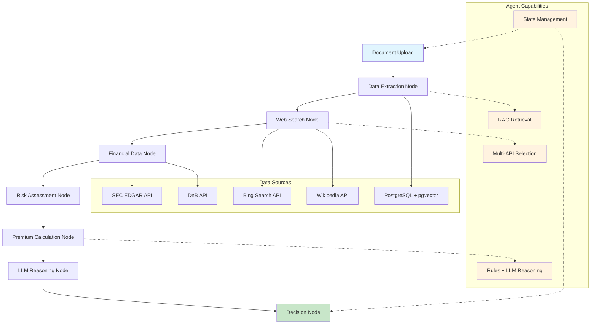

# Interview Preparation: Commercial Auto Insurance Underwriting Agent

This document contains the full interview script, flowchart, elevator pitch, and architectural rationale for the Commercial Auto Insurance Underwriting Agent repository.

## 1. Elevator Pitch (30 seconds)

This project is a commercial auto insurance underwriting agent that combines rules-based insurance logic with AI-enabled document understanding and external market intelligence. It uses a LangGraph workflow to orchestrate document retrieval, web and financial data enrichment, premium calculation, and final underwriting decisioning. The system is built for production with PostgreSQL+pgvector for semantic search, FastAPI for APIs, and optional AWS Lambda deployment with monitoring and security integration.

---

## 2. 20-Minute Voice-Over Script

### 2.1 Introduction (2 minutes)

Hello, my name is [Your Name] and I’m presenting the Commercial Auto Insurance Underwriting Agent. This repository is designed to show how to build a modern, production-capable underwriter using a hybrid of hard business rules, vector retrieval, external API integration, and agentic workflow orchestration.

At a high level, the system takes input from commercial auto applicants, ingests PDF documents such as MVRs and loss runs, performs semantic retrieval over stored documents, enriches the decision with web search and financial signals, and computes a premium with explainable business rules and optional LLM reasoning.

The main benefits of this approach are:

- **Explainability**: Premium calculations follow defined rules and are not hidden behind a purely opaque model.
- **Flexibility**: Document evidence and external signals are used as decision inputs.
- **Resilience**: The workflow is modular and can handle failures in individual steps.
- **Deployability**: The system is designed for AWS Lambda or containerized deployment with observability.

### 2.2 Problem Space and Why This Approach (3 minutes)

Commercial auto underwriting requires a combination of structured rule-based risk assessment and unstructured evidence extraction. Traditional underwriting systems rely heavily on static scoring rules. Pure LLM systems can handle unstructured text but may hallucinate, lack auditability, and cannot easily enforce insurance-specific requirements.

This repository is built to bridge that gap. It is not just an LLM or a rules engine:

- It uses **rules** for the premium calculator where predictability and compliance matter.
- It uses **RAG retrieval** to find relevant evidence from uploaded documents and stored data.
- It uses **external APIs** to enrich risk assessment with real-world signals.
- It orchestrates these pieces using **LangGraph** so each step is explicit, auditable, and can be debugged independently.

The fallback design decision here is a clear one: use a hybrid agentic architecture because underwriting is inherently a multi-step, stateful task. The alternative—a monolithic LLM—would not provide the same reliability and would be much harder to trace when decisions are contested.

### 2.3 Architecture Overview (4 minutes)

The architecture can be summarized in a DAG. The main node sequence is:

1. **Document ingestion and storage**
2. **RAG-enabled data extraction**
3. **Web search enrichment**
4. **Financial data enrichment**
5. **Risk assessment**
6. **Premium calculation**
7. **LLM reasoning and final decision**

The file structure reflects this architecture:

- `src/api/` hosts the FastAPI endpoints and Lambda compatibility.
- `src/agent/graph.py` contains the LangGraph workflow and state model.
- `src/retrieval/` contains document parsing, chunking, embeddings, and vector search.
- `src/premium/` contains the rules engine that computes premium adjustments.
- `src/web_search/` contains multi-API search agents.
- `src/financial/` contains the SEC and DnB data selection agent.
- `src/observability/` contains Ragas quality scoring, LangSmith tracing, and Prometheus metrics.

Using this architecture, the system can both enforce deterministic business logic and incorporate flexible evidence from documents and external information sources.

### 2.4 Core Business Rules in Code (3 minutes)

Now let me walk through the actual premium calculation logic.

The premium engine is implemented in `src/premium/calculator.py`. The core function is `calculate_premium(vehicle_info, risk_factors, web_search_results)`.

It applies these rules:

- **Base premium by vehicle type**: sedan $500, truck $1,200, van $800, fleet $5,000.
- **Claims surcharge**: +50% for each prior claim.
- **Serious accident surcharge**: +100% for each serious accident.
- **Violation surcharge**: +25% per traffic violation.
- **New business surcharge**: +40% for companies <1 year old.
- **Young business surcharge**: +20% for companies <3 years old.

Here is the actual code snippet:

```python
claim_count = risk_factors.get('claim_count', 0)
if claim_count > 0:
    adjustments['claims_history'] = claim_count * self.adjustment_rules['claim_multiplier']
```

This ensures that each claims event contributes materially to the premium. Similarly:

```python
serious_accidents = risk_factors.get('serious_accident_count', 0)
if serious_accidents > 0:
    adjustments['serious_accidents'] = serious_accidents * self.adjustment_rules['serious_accident_multiplier']
```

Those rules provide the predictable underwriting backbone.

Additionally, the system includes a minimum premium floor of $300 and rounds the final premium to the nearest dollar.

In practice, this means a truck with one claim and one violation would have a base premium of $1,200 and a total adjustment of 0.75, producing a final premium of 2,100.

### 2.5 Retrieval and RAG Implementation (4 minutes)

This is one of the most important innovations in the repository.

The retrieval layer is implemented in `src/retrieval/embeddings.py` and `src/retrieval/pgvector_client.py`.

The system uses `sentence-transformers` and the `all-MiniLM-L6-v2` embedding model. This model is small, efficient, and production-ready for semantic search.

The ingestion process does the following:

1. Extract PDF text with `PyPDF2` in `src/retrieval/pdf_parser.py`.
2. Chunk the document text into overlapping segments.
3. Generate embeddings for each chunk.
4. Store the embeddings in PostgreSQL using `pgvector`.

The vector search query is then:

```sql
SELECT e.chunk_text, e.metadata, d.document_type, d.applicant_id, d.filename,
1 - (e.embedding <=> :query_embedding) as similarity_score
FROM embeddings e
JOIN documents d ON e.document_id = d.id
ORDER BY e.embedding <=> :query_embedding
LIMIT :top_k
```

Using cosine similarity this way makes the system robust to vocabulary mismatch. If the application says “heavy delivery fleet,” the vector search can still retrieve a loss run chunk that mentions “cargo truck fleet with 30 vehicles.”

The Ragas client in `src/observability/ragas_client.py` evaluates retrieval quality by measuring:

- average similarity
- document count
- document type diversity

This gives us a pragmatic quality signal instead of a blind confidence score.

### 2.6 Multi-API Web Search Agent (3 minutes)

The project includes a `WebSearchAgent` in `src/web_search/web_search_agent.py`. This agent decides between:

- **Wikipedia API** for general company background and entity verification
- **Bing Search API** for current news, risk indicators, litigation, and operational issues

This is not a hardcoded single-API integration. The agent selects APIs based on the query type:

- `background` searches prioritize Wikipedia.
- `financial` and `comprehensive` searches include Bing.

That means the system can use the right tool for the right situation. If an underwriter wants company history, Wikipedia is very useful. If they want recent claims or legal incidents, Bing is better.

The code also deduplicates results and merges summaries from both sources.

### 2.7 Financial Data Agent (3 minutes)

Commercial underwriting needs financial data too.

That logic is encapsulated in `src/financial/financial_data_agent.py`, which chooses between:

- **SEC EDGAR public data** for filings and public company metrics
- **Dun & Bradstreet proprietary data** for private business credit and risk scoring

The selection is based on `data_preference` and the likely company type. For public companies, SEC is preferred for standardized financial statements. For private companies, DnB is preferred because it often has credit scores and risk indicators that are not publicly available.

A quick excerpt of the agent’s selection logic:

```python
if data_preference == 'public':
    return ['sec']
elif data_preference == 'proprietary':
    return ['dnb']
elif data_preference == 'both':
    return ['sec', 'dnb']
```

The agent then merges financial metrics from both sources, preferring SEC values for standardized metrics like revenue and net income, while still preserving DnB risk indicators.

This dual-source design is valuable because insurance underwriters often need both audited filings and proprietary credit information.

### 2.8 LangGraph Agentic Workflow (4 minutes)

The central workflow is built in `src/agent/graph.py` with LangGraph.

LangGraph is a workflow engine that models the underwriting pipeline as a state graph:

- `data_extraction`
- `web_search`
- `financial_data`
- `risk_assessment`
- `premium_calculation`
- `llm_reasoning`
- `decision`

Each node is a separate function that receives the state and returns an updated state. The state object is a Pydantic model named `UnderwritingState`, which contains:

- `applicant_id`
- `company_name`
- `vehicle_types`
- `risk_factors`
- `document_chunks`
- `web_search_results`
- `financial_data`
- `premium_calculation`
- `decision`
- `reasoning`
- `errors`

This structure gives us a traceable execution path and enables us to inspect exactly how a decision evolved.

The workflow is compiled and executed using LangGraph’s `StateGraph` API. This means the system can be extended with conditional edges, retries, or parallel branches later without rewriting the core logic.

This is one reason the architecture is agentic: it is designed for stateful, multi-step decisioning rather than a single request/response execution.

### 2.9 Why Agentic Over Alternatives (3 minutes)

Let me contrast the three main alternative approaches:

1. **Pure rules-based system**
2. **Pure LLM-based system**
3. **Agentic hybrid system**

#### Pure Rules-Based System
Pros:
- deterministic
- easy to audit
- easy to validate against regulations

Cons:
- brittle with unstructured data
- difficult to incorporate document evidence and external signals
- requires constant rule updates for new use cases

#### Pure LLM-Based System
Pros:
- can reason over unstructured text
- flexible with new data sources

Cons:
- hard to audit and explain underwriting decisions
- hallucination risk
- poor governance for regulated domains like insurance
- cannot easily enforce constraints such as minimum premium or allowable surcharge caps

#### Agentic Hybrid System (This Project)
Pros:
- preserves deterministic premium rules
- adds semantic evidence retrieval
- integrates multiple external sources in a managed pipeline
- provides clear state and traces for each step
- enables easier debugging and monitoring

This is why the repository uses LangGraph. It gives us the best tradeoff between reliability and flexibility. We can keep the underwriting rules intact while still allowing AI and retrieval to provide evidence and explanation.

### 2.10 Observability and Deployability (2 minutes)

The repository also includes observability and deployment patterns.

Observability:
- **Prometheus metrics** for API endpoints and workflow execution
- **LangSmith tracing** for agent execution and LLM calls
- **Ragas quality metrics** for retrieval performance
- **Arize Phoenix** for monitoring model outputs and data drift

Deployability:
- `FastAPI` REST interface
- `Mangum` compatibility for AWS Lambda
- `docker-compose` for local development
- `AWS EKS` and `SageMaker` hooks for production scale

Key production controls are in place:
- input validation via `Llama Guard`
- AWS WAF guidance for API security
- environment-based configuration via `pydantic-settings`

### 2.11 Closing Summary (1 minute)

In summary, this project is designed as a production-grade underwriting agent. It is not a toy demo: it is structured for deployment, observability, and corporate risk management.

The core intellectual contribution is the hybrid architecture that combines:
- deterministic premium rules,
- semantic RAG retrieval,
- multi-source external data selection,
- and agentic workflow orchestration.

That combination is what makes this solution more robust than a simple rules engine and more reliable than a pure LLM.

If you want to highlight one thing, emphasize that the system is built for commercial underwriting with explainable output and a managed decision pipeline.

---

## 3. Mermaid Flowchart



---

## 4. Interview Tips

- **Start with the problem**: explain why commercial auto underwriting needs both rules and evidence.
- **Emphasize hybrid architecture**: this is a deliberate combination of deterministic and intelligent components.
- **Call out the DAG**: the workflow is not just sequential, it is a stateful agent pipeline.
- **Stress observability**: mention LangSmith, Prometheus, Ragas, and Arize.
- **Be ready to compare alternatives**: the strongest answer is why this approach is better than a rule engine, a pure LLM, or a basic ETL pipeline.

---

## 5. Notes for Practice

- Read the script aloud once to test pacing.
- Focus on the sections where you can speak confidently about code: premium rules, RAG retrieval, multi-API search, and LangGraph.
- Use the Mermaid flowchart as your visual anchor if asked to explain the architecture.
- If asked about limitations, say the system is intentionally hybrid to manage tradeoffs between explainability and flexibility.
